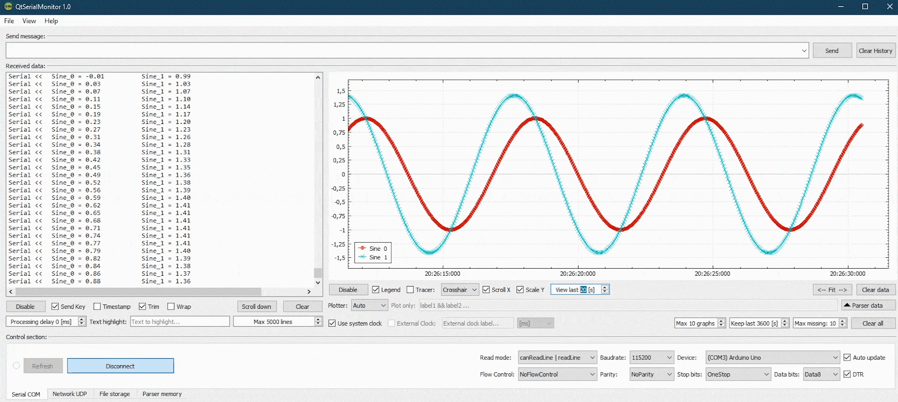

<p align="center">
  <h1 align="left">QtSerialMonitor </h1>
  <p align="left">
   <a href="https://github.com/mich-w/QtSerialMonitor/blob/master/LICENSE">    </a>
   <a href="https://github.com/mich-w/QtSerialMonitor/releases"> </a>
   <a href="https://github.com/mich-w/QtSerialMonitor/releases"> </a>
  </p>
</p>

Universal serial monitor with data plotting capabilities, based on [Qt](https://www.qt.io/). Designed with all sorts of [Arduino](https://www.arduino.cc/) projects in mind, as a handy tool for debugging and experimentation :) 



<p>


</p>

**Features:**
- Serial and UDP terminal: text, HEX or binary view, command history (Up/Down), macro buttons, periodic send,
- Live plotter with multiple graphs, pause and history scroll bar, tracer, filtering - uses [QCustomPlot](https://www.qcustomplot.com/),
- Understands plain `label value` text, CSV, Arduino Serial Plotter (`a:1,b:2`) and [Teleplot](https://github.com/nesnes/teleplot) (`>a:1`) formats,
- Per-channel statistics: min, max, mean, count and sample rate,
- Auto-reconnect when a USB device is unplugged and plugged back in,
- Read/write ".csv", ".txt" data logs; large files load in the background,
- Light and dark themes (or follow the system),
- Demo mode - a simulated device streaming sine waves, no hardware needed (`QtSerialMonitor --demo`),
- Printer support, export chart as PNG, JPG, BMP or PDF,
- Runs on Windows, Linux and macOS with Qt 6 (or Qt 5.15).

Downloads for Windows and macOS are attached to each [release](https://github.com/mich-w/QtSerialMonitor/releases). See [CHANGELOG.md](CHANGELOG.md) for what changed.
-
---

**Work in progress:**
  
    - 3D Orientation Demo - for IMU testing (user will be able to toggle between chart view
      and a simple 3D scene containing an object rotating accordingly to received roll,
      pitch and yaw values, representing the sensor's orientation),

    - Improvements, fixes etc.

----

**Building from source:**

Requirements: CMake ≥ 3.16, a C++17 compiler and Qt 6 (or Qt 5.15) with the *SerialPort* module.

```sh
cmake -S . -B build -DCMAKE_BUILD_TYPE=Release
cmake --build build -j
./build/QtSerialMonitor
```

Try it without any hardware: `./build/QtSerialMonitor --demo` (optionally `--demo-rate 100` for samples per second), or pick *(Demo) Simulated sine waves* from the device list. Run with `--help` for all options.

Qt 6 is used when available; pass `-DQTSM_QT_MAJOR=5` to build against Qt 5.15. If CMake can't find Qt, point it at your installation with `-DCMAKE_PREFIX_PATH=/path/to/Qt/6.x/gcc_64`.

----

***Notes:***

* The app uses a custom-written parser, which searches the incoming message for plottable data in form of label-value set. At the moment, all labels and values **must be separated with a whitespace** in order to be recognized. Its possible to use separators like "=" and "," - parser will be replace them with whitespace before processing. If no label is found, a generic name will be used i.e. "Graph 0".*

        Examples of supported formats:

        - "Roll = 1.23 Pitch = 45.6"
        - "Voltage: 1.23 (tabulator) Output: 4.56"
        - "1.23 4.56" (Graph 0 and Graph 1)
        - "temp=2.5e-3, rpm=+1200" (scientific notation and signs are supported)
        - "Sensor1:12,Sensor2:34" (Arduino IDE 2 Serial Plotter format)
        - ">temp:21.5" or ">temp:1627551892437:21.5" (Teleplot format, one value per line)
 
* Application uses QtSettings functionality and stores a simple .ini file on the hard drive in which it keeps its settings. It is stored in the user's configuration directory, e.g. *%APPDATA%\QtSerialMonitor* on Windows or *~/.config/QtSerialMonitor* on Linux. The settings are saved each time the app closes.
