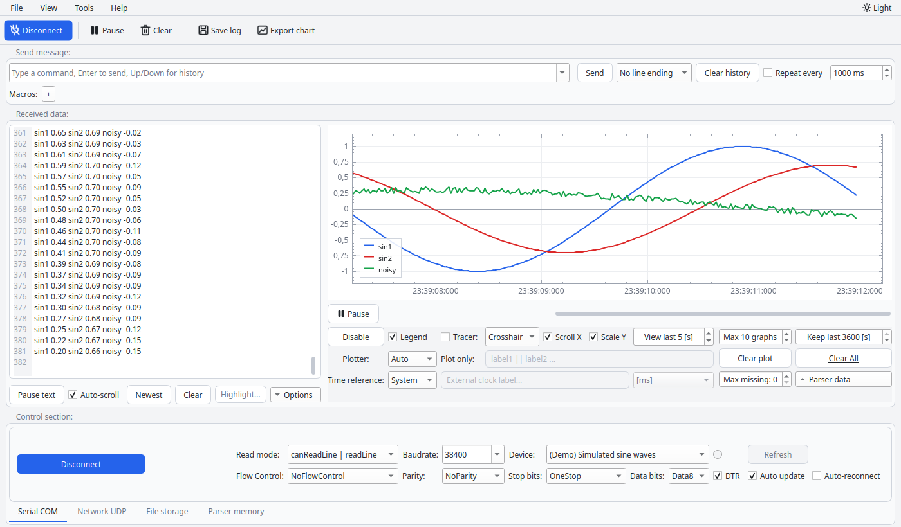
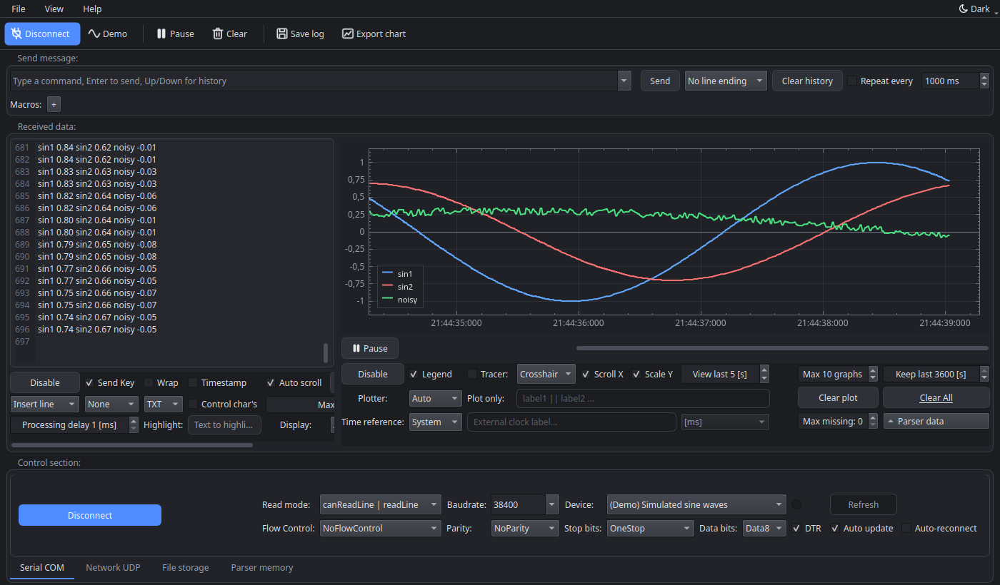
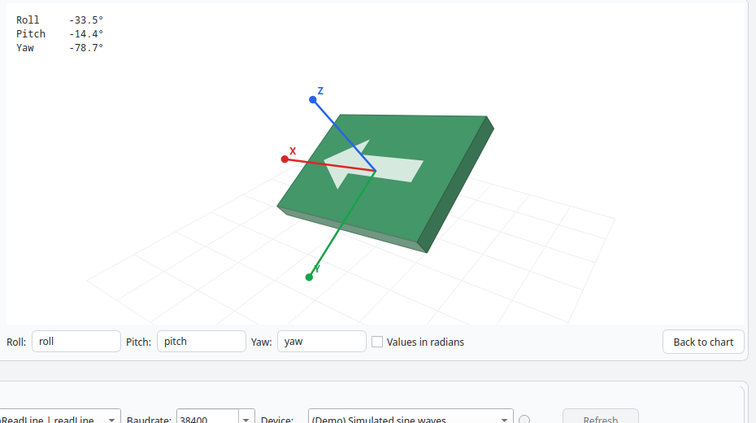

<p align="center">
  <h1 align="left">QtSerialMonitor</h1>
  <p align="left">
   <a href="https://github.com/mich-w/QtSerialMonitor/blob/master/LICENSE"></a>
   <a href="https://github.com/mich-w/QtSerialMonitor/releases"></a>
   <a href="https://github.com/mich-w/QtSerialMonitor/releases"></a>
  </p>
</p>

Serial monitor and live data plotter built with [Qt](https://www.qt.io/). Made with [Arduino](https://www.arduino.cc/) and other microcontroller projects in mind - print values from your board and see them plotted right away, no special protocol needed.

<p>


</p>

## Features

- **Terminal** for serial ports and UDP - text, HEX or binary view, highlighting, timestamps
- **Sending** - command history with Up/Down, macro buttons, periodic send
- **Live plotter** with any number of graphs - pause, history scroll bar, tracer, zoom, filtering (uses [QCustomPlot](https://www.qcustomplot.com/))
- **Understands common formats** - plain `label value` text, CSV, Arduino Serial Plotter and [Teleplot](https://github.com/nesnes/teleplot)
- **Statistics** per channel - min, max, mean, count and sample rate
- **3D orientation view** for IMUs - a board rotated by your roll / pitch / yaw values
- **Auto-reconnect** when a USB device is unplugged and plugged back in
- **Logging** to CSV or text files; logs can be loaded back and plotted
- **Light and dark theme**, or follow the system
- **Demo mode** - a simulated device streaming sine waves, no hardware needed
- Export the chart as PNG, JPG, BMP or PDF, print the chart or the log
- Windows, Linux and macOS, Qt 6 (or Qt 5.15)

## Download

Builds for Windows and macOS are attached to each [release](https://github.com/mich-w/QtSerialMonitor/releases). On Linux, [build from source](#building-from-source) - it only takes a minute. See [CHANGELOG.md](CHANGELOG.md) for what's new.

## Quick start

1. Pick your device in the **Serial COM** tab at the bottom, set the baud rate and press **Connect**.
2. Print values from your board, for example:
   ```cpp
   Serial.print("temp ");  Serial.print(temperature);
   Serial.print(" hum ");  Serial.println(humidity);
   ```
3. Each label becomes a graph. That's it.

No board at hand? Use **Tools → Demo device** or start the app with `--demo`.

## Supported data formats

Every received line is searched for label/value pairs. Values without a label are named `Graph 0`, `Graph 1`, ...

| Example | Notes |
|---|---|
| `temp 21.5 hum 40` | label and value separated by whitespace |
| `Roll = 1.23, Pitch = 45.6` | `=` and `,` work as separators too |
| `Voltage: 1.23	Output: 4.56` | trailing `:` on the label is fine, tabs too |
| `1.23 4.56` | no labels - `Graph 0`, `Graph 1` |
| `temp=2.5e-3 rpm=+1200` | scientific notation and explicit signs |
| `Sensor1:12,Sensor2:34` | Arduino IDE 2 Serial Plotter |
| `>temp:21.5` | Teleplot, one value per line |
| `>temp:1627551892437:21.5` | Teleplot with a timestamp in ms |

Time stamps come from the PC clock by default. To use your device's time instead, set **Time reference** under the chart to an external clock - either a label carrying milliseconds (e.g. `time 12345`) or a time of day in the line (`12:34:56.789`).

**CSV files** (also the app's own logs) can be loaded with **File → Import...** (Ctrl+O). The first row is the header; `,` `;` and tab delimiters, quoted fields and empty cells are handled.

## 3D orientation view



**View → Change visualisation → 3D Orientation** (Ctrl+9) shows a board rotated by the latest `roll`, `pitch` and `yaw` values (label names and degrees/radians can be changed below the view). Positive roll lowers the right side, positive pitch raises the nose, positive yaw turns clockwise seen from above. The demo device sends these values while the view is open. Drag with the mouse to look around, use the wheel to zoom and double-click to reset the view.

## Tips

| | |
|---|---|
| Ctrl+, | Settings - theme, chart engine, refresh rate, line quality, OpenGL |
| Space or P (chart focused) | pause / resume the chart |
| T / X / Y / L (chart focused) | toggle tracer / auto scroll X / auto scale Y / legend |
| Double-click the chart | fit all data |
| Middle mouse button drag | zoom into a rectangle |
| Ctrl+1 / Ctrl+2 / Ctrl+3 | text only / 50:50 / chart only |
| Ctrl+8 / Ctrl+9 | plotter / 3D orientation |
| F1 | "What's this?" mode - click any control to see what it does |

At high data rates (hundreds of lines per second) choose **Fast** line rendering in the settings, or try the experimental **Qt Graphs** chart engine, which draws on the GPU (Qt 6.8+ builds; the tracer is not available there yet).

## Command line

```
QtSerialMonitor [--demo] [--demo-rate <hz>] [--help] [--version]
```

- `--demo` - start streaming from the simulated device
- `--demo-rate <hz>` - samples per second for the demo device (1-1000, default 50)

## Building from source

Requirements: CMake 3.16+, a C++17 compiler and Qt 6 (or Qt 5.15) with the *SerialPort* module.

```sh
cmake -S . -B build -DCMAKE_BUILD_TYPE=Release
cmake --build build -j
./build/QtSerialMonitor
```

On Debian/Ubuntu the dependencies are `cmake g++ qt6-base-dev qt6-serialport-dev libqt6opengl6-dev`, on Arch/Manjaro `cmake qt6-base qt6-serialport`. For the optional Qt Graphs chart engine add Qt Graphs (Qt 6.8+, e.g. `qt6-graphs` on Arch).

Options:

- `-DQTSM_QT_MAJOR=5` - build against Qt 5.15 instead of Qt 6
- `-DQTSM_OPENGL=OFF` - build without the optional OpenGL chart rendering
- `-DQTSM_QT_GRAPHS=OFF` - build without the optional Qt Graphs chart engine
- `-DCMAKE_PREFIX_PATH=/path/to/Qt/6.x/gcc_64` - if CMake can't find Qt

Run the tests with `ctest --test-dir build`.

## Settings

Settings are saved when the app closes, in an `.ini` file in the user's configuration folder - `%APPDATA%\QtSerialMonitor` on Windows, `~/.config/QtSerialMonitor` on Linux. Logs go to `Documents/QtSerialMonitor/Logs` by default.

## License

[GPL-3.0](LICENSE). QCustomPlot is GPL-3.0 as well, see [third_party/qcustomplot](third_party/qcustomplot).
